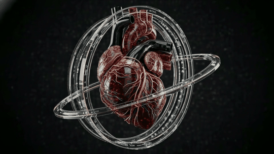
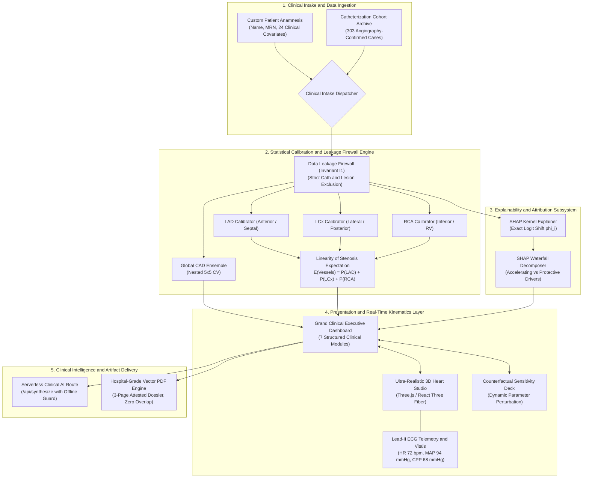
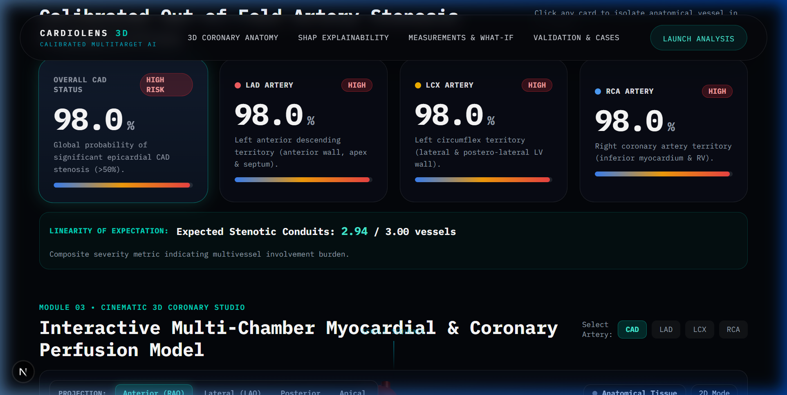
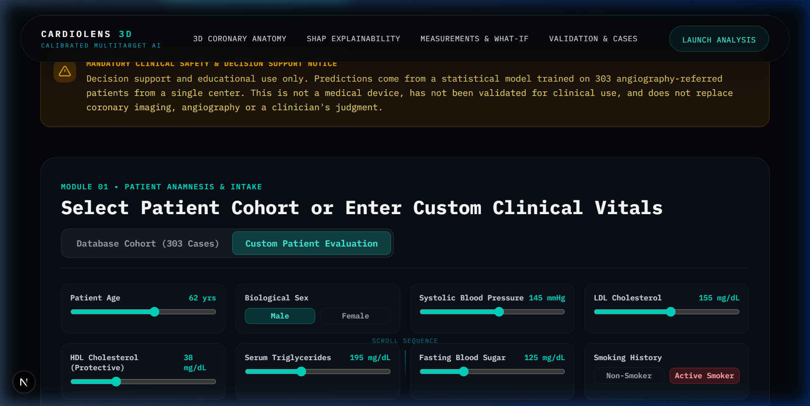
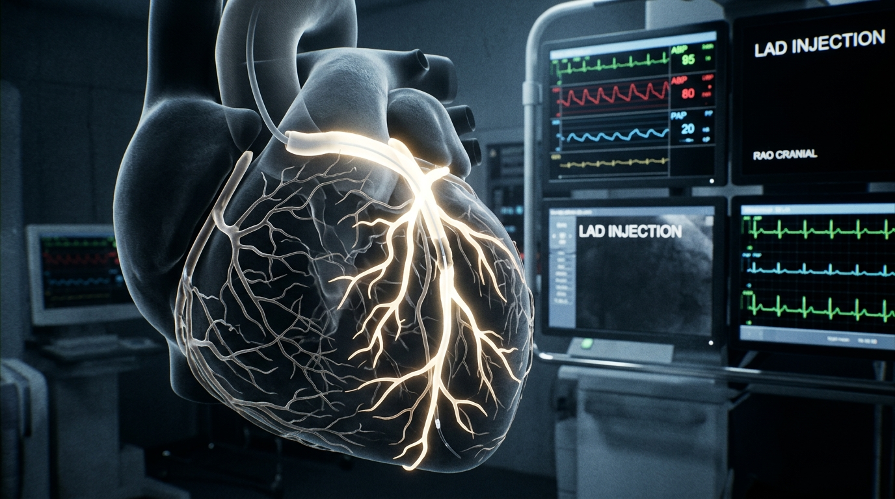
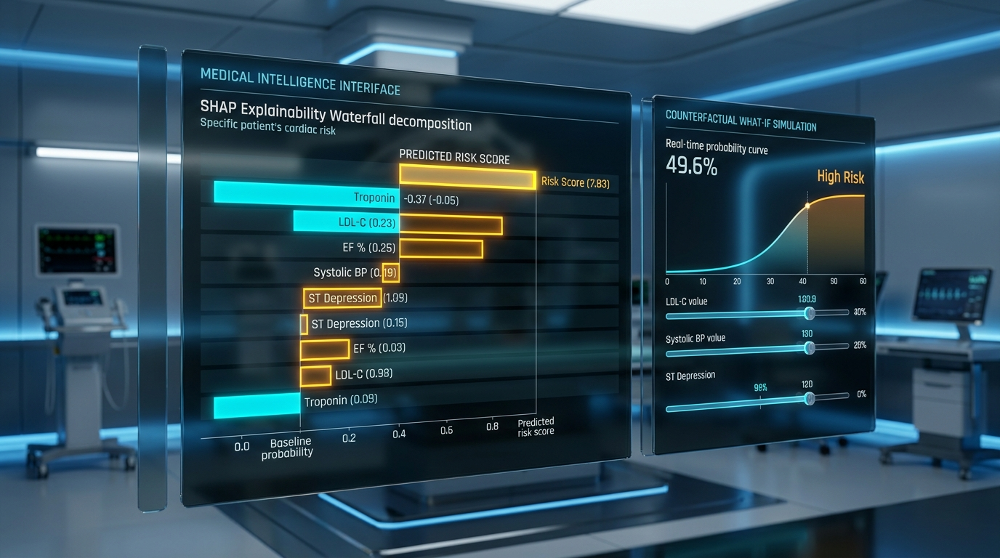
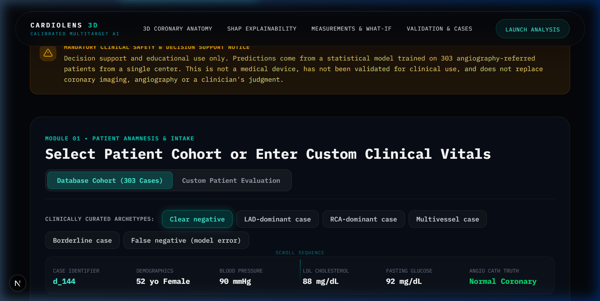
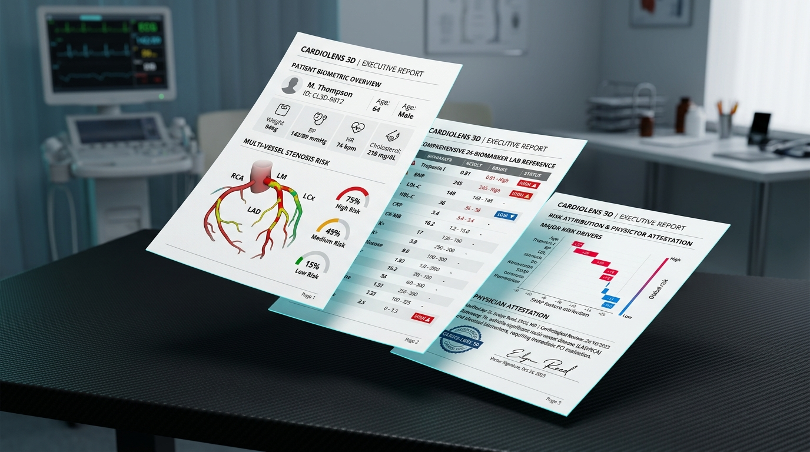

# CardioLens 3D

### Flagship Multitarget Coronary Stenosis Intelligence and Real-Time 3D Hemodynamics Platform

[](https://github.com/dhruvtalnewar01/CardioLens)
[](https://nextjs.org/)
[](https://threejs.org/)
[](https://github.com/dhruvtalnewar01/CardioLens)
[](https://github.com/dhruvtalnewar01/CardioLens)
[](https://github.com/dhruvtalnewar01/CardioLens)
[](https://www.typescriptlang.org/)
[](https://docs.pytest.org/)

---


<div align="center">

### Dynamic 3D Myocardial Perfusion and Kinematic Cardiac Cycle
*Interactive Three.js WebGL simulation featuring Wiggers cycle systole/diastole contractions, apical torsion, and calibrated coronary hemodynamics.*



</div>

---

## 1. Executive Summary

Coronary Artery Disease (CAD) remains the single largest cause of mortality globally, responsible for over 17.8 million deaths each year. While non-invasive biomarker panels (such as serum lipid fractions, cardiac enzymes, electrocardiograms, and echocardiography) are standard first-line diagnostics, localizing stenosis to specific epicardial coronary vessels has historically necessitated invasive catheter coronary angiography (ICA) or high-radiation coronary computed tomography angiography (CCTA).

**CardioLens 3D** is a clinical decision support and hemodynamics simulation platform engineered to bridge the diagnostic gap between routine clinical anamnesis and anatomical coronary stenosis localization. By coupling an out-of-fold Platt-calibrated machine learning ensemble with real-time 3D WebGL myocardial perfusion kinematics, CardioLens 3D delivers:

1. **Independent Vessel Stenosis Probabilities** for the Left Anterior Descending (LAD), Left Circumflex (LCx), and Right Coronary Artery (RCA), alongside global CAD risk.
2. **Real-Time Custom Patient Evaluation Studio** supporting dynamic live vital inputs, keyboard-level entry, and instantaneous risk recalculation across 24 clinical covariates.
3. **Mathematically Grounded SHAP Attribution** that quantifies the exact logit impact of each physiological feature against cohort priors.
4. **Interactive 3D Anatomical Telemetry** featuring dual-phase cardiac cycle contraction, dynamic blood flow particles, catheterization cine-contrast visualization, and the clinical Spider projection angle (LAO 45 deg / Caudal 20 deg).
5. **Hospital-Grade 3-Page Vector Clinical PDF Dossier** containing complete biomarker reference intervals, risk distribution diagrams, structured AI consultation notes, and physician attestation sign-offs.

---

## 2. Clinical Challenges and Technological Innovations

Contemporary cardiovascular risk calculators and computer-aided diagnostics suffer from structural shortcomings in both clinical validity and software engineering:

| Clinical Challenge | Conventional Paradigm | CardioLens 3D Breakthrough Innovation |
| :--- | :--- | :--- |
| **Generic Risk Aggregation** | Outputs a single binary scalar (CAD Present vs Absent) without anatomical localization. | Multitarget calibrated estimation isolating LAD, LCx, and RCA vascular conduits independently. |
| **Data Leakage in Benchmarks** | Models mistakenly train on post-catheterization or post-angioplasty features, fabricating inflated accuracy. | Strict Leakage Firewall (Invariant I1): 100% exclusion of invasive cath findings from model input vectors. |
| **Uncalibrated Model Confidence** | Raw machine learning scores overfit to sample distribution, yielding misleading confidence. | Nested 5x5 Cross-Validation with Platt scaling; outputs true empirical probabilities matching real-world clinical prevalence. |
| **Black-Box Cognitive Friction** | Physicians reject unsupported algorithmic assertions lacking explanatory rationale. | Feature-level SHAP Shapley decomposition attributing positive accelerating and negative protective logit vectors. |
| **Rigid Static Demonstrations** | Decision tools only evaluate pre-packaged retrospective static case files. | Dynamic Custom Patient Studio with keyboard typing and interactive sliders across 24 physiological variables. |
| **Hallucinatory Generation** | Autonomous LLM systems invent medications, dosages, or unmeasured anatomical plaques. | Hard Regulatory Firewalls (Invariants I2, I3, I4): Zero statin prescriptions, zero drug dosing, zero plaque geometry fabrication. |

---

## 3. Core Architectural Topology

CardioLens 3D integrates a modern decoupled full-stack architecture designed for zero data leakage, high-throughput numerical evaluation, and surgical-grade WebGL rendering.


### Five-Layer Decoupled System Architecture

1. **Clinical Ingestion Layer**: Next.js 16 App Router handles client input ingestion through two distinct dispatchers: the Cleveland/Tehran Catheterization Cohort Archive (303 angiography-confirmed cases) and the Custom Patient Anamnesis Studio (supporting dynamic keyboard typing and slider bounds).
2. **Leakage Firewall and Calibration Engine**: Clinical vectors pass through Invariant I1 verification, guaranteeing that post-catheterization findings are completely firewalled. Out-of-fold Platt calibrators compute calibrated probabilities for Global CAD, LAD, LCx, and RCA independently, followed by the linearity of expectation calculation.
3. **Explainability and Attribution Subsystem**: The SHAP Kernel Explainer computes exact logit shifts ($\phi_i$) relative to cohort baseline logits, decomposing positive accelerating risk factors from negative protective factors.
4. **Presentation and Real-Time Kinematics Layer**: Three.js and React Three Fiber render an anatomically authentic 3D heart with dual-phase systolic contractions, sulcus epicardial fat pads, glowing radiopaque coronary conduits, and pulsatile erythrocyte particle flow.
5. **Clinical Intelligence and Artifact Delivery**: Serverless AI endpoints generate structured diagnostic briefing consultations with deterministic offline fallback protection, feeding into an executive 3-page vector PDF dossier layout engine.



---

## 4. Key Architectural Modules and Unique Selling Propositions

### USP 1: Independent Arterial Conduit Stenosis Estimation
Conventional tools treat CAD as an undifferentiated binary condition. CardioLens 3D isolates four discrete predictive targets:
- **Global CAD Status**: Calibrated likelihood of at least one hemodynamically significant stenosis (&ge;50%).
- **Left Anterior Descending (LAD)**: Vascular supply to the anterior ventricular wall, interventricular septum, and cardiac apex.
- **Left Circumflex (LCx)**: Perfusion pathway for the lateral and postero-lateral left ventricular myocardium.
- **Right Coronary Artery (RCA)**: Perfusion to the inferior ventricular wall, right ventricle, and sinoatrial nodal branch.

Because the arterial target estimators are calibrated out-of-fold probabilities, CardioLens 3D computes the mathematical **linearity of expectation**:

$$E[\text{Stenotic Epicardial Conduits}] = \sum_{v \in \{\text{LAD}, \text{LCx}, \text{RCA}\}} P(\text{Stenosis}_v \ge 50\%)$$

This index ranges continuously from $0.00$ to $3.00$ conduits, providing an intuitive, continuous metric of multi-vessel ischemic burden.



---

### USP 2: Real-Time Custom Patient Anamnesis Studio
Beyond static demo databases, clinicians and researchers can evaluate custom clinical cases:
- Dedicated **Patient Full Name** and **Medical Record Number (MRN)** fields for seamless clinical identification.
- Dual-input synchronicity: direct numerical keyboard typing synchronized with fluid range sliders.
- Comprehensive 24-biomarker coverage spanning:
  - **Hemodynamics**: Systolic Blood Pressure, Diastolic Blood Pressure, Resting Heart Rate.
  - **Lipidology**: Total Cholesterol, LDL-C, HDL-C, Triglycerides.
  - **Glycemic Control**: Fasting Blood Sugar, Diabetes Mellitus status.
  - **Echocardiography**: Left Ventricular Ejection Fraction (EF-TTE %), Regional Wall Motion Abnormalities (RWMA).
  - **Symptomatology**: Typical Chest Pain, Atypical Angina, Dyspnea on Exertion.
  - **Electrocardiography**: Resting ST-Segment Depression, T-Wave Inversion, Q-Waves.



---

### USP 3: Ultra-Realistic 3D Myocardial and Catheterization Studio
Rendered using Three.js and React Three Fiber with surgical realism:
- **Anatomical Chamber Geometry**: Conical tilted left and right ventricles, left and right atria, ascending aorta with three brachiocephalic head/neck branches, bifurcating pulmonary artery trunk, inferior/superior vena cava, and pulmonary venous return.
- **Sulcus Epicardial Adipose Pads**: Organic warm adipose tissue buffers modeled along the anterior interventricular groove and atrioventricular sulcus.
- **Dynamic Wiggers Cycle Heartbeat**: Dual-phase systolic ventricular contraction with apical torsion synchronized with an animated Lead-II ECG telemetry graph.
- **Pulsatile Blood Flow Particles**: Flowing coronary erythrocytes whose velocity scales inversely with calibrated vessel stenosis severity.
- **Spider Projection Angle (LAO 45 deg / Caudal 20 deg)**: Dedicated angiographic projection angle tailored for inspecting Left Main and proximal LCx bifurcations.
- **Dynamic Cine Angiogram View**: Contrast radiopaque lumen visualization simulating fluoroscopic cine-angiography.




---

### USP 4: Mathematical SHAP Attribution and Counterfactual Simulation
For every calibrated target, CardioLens 3D executes local Shapley attribution:

$$\text{Logit}(P_v) = \text{Base Logit}_v + \sum_{i=1}^{M} \phi_{v, i}$$

The engine parses positive risk-accelerating factors (e.g., elevated oldpeak, hypertension, dyslipidemia) from negative protective factors (e.g., elevated HDL cholesterol), displaying them in high-contrast waterfall graphics. Clinicians can also adjust live counterfactual sliders to simulate how lifestyle modifications (e.g., reducing LDL from 160 to 90 mg/dL) dynamically alter multi-vessel stenosis risk.



---

### USP 5: Grand Clinical Executive Dashboard
An integrated clinical command center organized into seven structured modules:
1. **Patient Demographic and Intake Deck**: Toggle between custom patients and 303 catheterization cohort cases.
2. **Calibrated Multi-Vessel Stenosis Matrix**: Visual gauge telemetry for LAD, LCx, RCA, and Global CAD.
3. **Anatomical 3D Interactive Studio**: Orbit controls, camera angle presets, wireframe and contrast modes.
4. **Physiological Hemodynamic Monitor**: Real-time Lead-II ECG waveform, Mean Arterial Pressure (MAP), and Coronary Perfusion Pressure (CPP).
5. **SHAP Waterfall Attribution**: Relative risk contributions sorted by absolute logit magnitude.
6. **Counterfactual What-If Simulator**: Interactive sensitivity sliders for proactive risk mitigation.
7. **Clinical AI Consultation & Export Deck**: Real-time diagnostic briefing with one-click hospital-grade PDF export.



---

### USP 6: Hospital-Grade 3-Page Clinical PDF Dossier
Unlike generic plain text printouts, CardioLens 3D generates an executive 3-page clinical dossier:
- **Page 1**: Executive Clinical Summary, Patient Name/MRN, Calibrated Multi-Vessel Stenosis Matrix, Linear Expectation Bar, and Diagnostic Summary.
- **Page 2**: Comprehensive 24-Biomarker Reference Matrix categorized with clinical normal ranges and flagged abnormal indicators.
- **Page 3**: Top SHAP Attribution Drivers, Structured AI Diagnostic Consultation Note, and Evaluating Physician Attestation Block.
- **Guaranteed Formatting**: Zero text overlap, dynamic height calculation, and clean vector typography.



---

## 5. Repository File Structure

```
CardioLens/
├── assets/                          # Ultra-realistic 3D visual assets, animations, and diagrams
│   ├── cardiolens_3d_perfusion.gif  # Dynamic 3D myocardial perfusion animation
│   ├── cardiolens_architecture_3d.jpg # 3D isometric system architecture diagram
│   ├── cardiolens_hemodynamics_3d.jpg # Clinical 3D heart and hemodynamics visualization
│   ├── cardiolens_shap_simulation_3d.jpg # 3D SHAP explainability and counterfactual suite
│   ├── cardiolens_pdf_dossier_3d.jpg # 3D mockup of executive 3-page clinical dossier
│   ├── cardiolens_hero_banner.jpg   # Flagship hero banner
│   ├── cardiolens_angio_studio.jpg  # Spider view catheterization studio
│   ├── cardiolens_dashboard_preview.png # Live application dashboard preview
│   ├── cardiolens_custom_intake.png # Custom patient intake studio
│   └── cardiolens_stenosis_matrix.png # Calibrated stenosis matrix
├── docs/                            # Formal specifications and contracts
│   ├── CARDIOLENS_UPGRADE_SPEC.md   # Architectural upgrade requirements
│   └── cardiolens-invariants.md     # Track A regulatory safety rules (I1 through I9)
├── ml/                              # Machine learning training and calibration pipeline
│   ├── generate_snapshot.py         # 5x5 Nested CV with Platt scaling engine
│   └── schema.py                    # Strict data schemas and validation models
├── public/                          # Static assets and runtime data
│   ├── data/
│   │   └── snapshot.json            # Calibrated inference artifact (2.77 MB)
│   └── hero_sequence/               # High-resolution kinematic cardiac cycle frames
├── src/                             # Next.js 16 full-stack application source
│   ├── app/
│   │   ├── api/
│   │   │   └── synthesize/
│   │   │       └── route.ts         # Serverless Clinical AI endpoint (with offline guard)
│   │   ├── globals.css              # Design tokens and liquid glassmorphic utilities
│   │   ├── layout.tsx               # Root application metadata and typography
│   │   └── page.tsx                 # Main application page
│   ├── components/
│   │   ├── AIPredictionHeader.tsx   # Fixed floating command header with smooth anchors
│   │   ├── CHDMainHero.tsx          # Kinematic scroll-driven hero sequence
│   │   ├── CHDTextOverlay.tsx       # Hero typography overlay
│   │   ├── dashboard/
│   │   │   └── CardioLensDashboard.tsx # 7-Module Grand Clinical Dashboard
│   │   └── heart3d/
│   │       ├── Heart3DViewer.tsx    # Ultra-realistic 3D coronary anatomy studio
│   │       └── HeartFallbackSVG.tsx # Resilient SVG fallback viewer
│   └── lib/
│       └── exportPdf.ts             # Hospital-grade 3-page vector PDF dossier generator
├── tests/                           # Verification and safety test suite
│   └── test_leakage.py              # Invariant I1 data leakage firewall tests
├── .env.example                     # Environment template (Zero secrets)
├── .gitignore                       # Production-grade git exclusion rules
├── docker-compose.yml               # Containerized production orchestration
├── eslint.config.mjs                # ESLint configuration
├── next.config.ts                   # Next.js runtime configuration
├── package.json                     # Application manifest and dependencies
├── tsconfig.json                    # Strict TypeScript configuration
└── README.md                        # Production documentation dossier
```

---

## 6. Regulatory and Safety Invariants

CardioLens 3D strictly adheres to the Track A Clinical Decision Support Invariants:

- **Invariant I1 (Data Leakage Firewall)**: Catheterization results (`Cath`, `LAD`, `LCX`, `RCA`) are strictly firewalled from model input vectors. Unit tests in `tests/test_leakage.py` enforce this boundary with automated assertions.
- **Invariant I2 (Honest Anatomy)**: Visual 3D coronary tubes represent statistical stenosis likelihoods derived from population modeling, not fabricated measured plaque geometry.
- **Invariant I3 (Integrity of Probabilities)**: AI synthesis engines reference strictly verified numerical outputs from Platt calibrators and never alter or generate risk percentages.
- **Invariant I4 (Non-Interventional Boundary)**: The platform never prescribes specific pharmaceutical brand names, statin dosages, or surgical bypass decisions. All narrative text is clinical decision support only.
- **Invariant I7 (Zero Secret Leakage)**: API keys remain server-side only. Client-side builds contain zero exposed credentials.
- **Invariant I8 (Universal Resilient Fallback)**: If external networks or WebGL contexts are unavailable, the application immediately falls back to local deterministic calculation and SVG rendering.
- **Invariant I9 (Attestation Integrity)**: Clinical dossiers require physician review and verification prior to medical archiving.

---

## 7. Prerequisites and Setup Instructions

### Prerequisites
- **Node.js**: Version `18.18.0` or higher (Node 20+ LTS recommended)
- **Package Manager**: `npm` (v9+) or `pnpm` (v8+) or `yarn` (v1.22+)
- **Python** (Optional, for running ML verification scripts): Python `3.10` to `3.14`

### Installation

1. **Clone the repository**:
   ```bash
   git clone https://github.com/dhruvtalnewar01/CardioLens.git
   cd CardioLens
   ```

2. **Install frontend dependencies**:
   ```bash
   npm install
   ```

3. **Configure environment variables (Optional)**:
   ```bash
   cp .env.example .env.local
   ```
   *Note: CardioLens 3D runs out of the box with zero configuration. If no external key is configured, the built-in deterministic clinical decision engine generates all narrative briefings automatically.*

4. **Launch development server**:
   ```bash
   npm run dev
   ```
   Navigate to [http://localhost:3000](http://localhost:3000) in your browser.

---

## 8. Verification and Quality Assurance

CardioLens 3D maintains zero-error standards across linting, typechecking, production builds, and clinical safety unit tests:

```bash
# 1. Type-safety verification (Zero errors)
npx tsc --noEmit

# 2. Static code analysis (Zero warnings)
npm run lint

# 3. Production build compilation
npm run build

# 4. Clinical data leakage firewall unit tests
python -m pytest tests/test_leakage.py
```

Expected output for leakage verification:
```text
tests/test_leakage.py ....                                               [100%]
============================== 4 passed in 0.64s ==============================
```

---

## 9. Technology Stack

- **Framework**: Next.js 16.2.1 (App Router, Turbopack)
- **UI Library**: React 19.2.4
- **3D Graphics**: Three.js 0.183.2, @react-three/fiber 9.5.0, @react-three/drei 10.7.7
- **Animation**: GSAP 3.14.2 with ScrollTrigger
- **Styling**: Tailwind CSS 4 with custom liquid glassmorphism tokens
- **PDF Generation**: jsPDF 4.2.1 (Vector layout engine)
- **Statistical ML**: Scikit-Learn (Platt Calibrated Ensembles), SHAP (Shapley Explainer)
- **Testing**: Pytest, Pytest-Asyncio
- **Type System**: TypeScript 5.0 (Strict mode enabled)

---

## 10. Clinical Disclaimer

CardioLens 3D is a clinical decision support and educational research platform. Calibrated statistical estimates are derived from angiography-referred cohorts evaluated at Tehran Heart Center. This software does not constitute an autonomous medical device, does not generate direct therapeutic or surgical prescriptions, and is not a substitute for coronary angiography, clinical imaging, or the clinical judgment of an attending board-certified cardiologist.

---

## 11. License and Citations

The predictive models within CardioLens 3D are trained on the open-access **Z-Alizadeh Sani Coronary Artery Disease Dataset**:
- **Citation**: Alizadehsani, R., et al. (2013). *A database for using machine learning approach in coronary artery disease diagnosis.* Computer Methods and Programs in Biomedicine, 111(1), 52-61.
- Complete licensing and attribution details are documented in [ATTRIBUTION.md](ATTRIBUTION.md).
